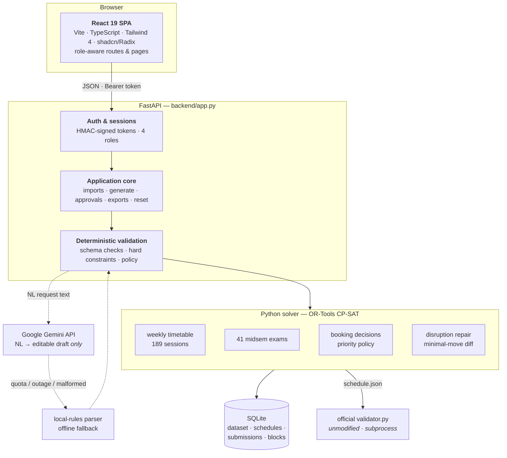
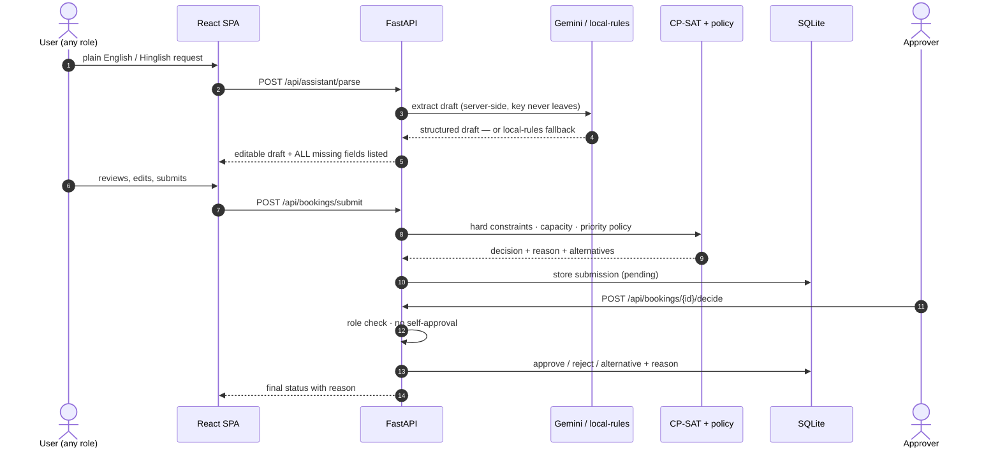

<div align="center">


# CIT Scheduler

**Campus Scheduling & Venue Management for Chilika Institute of Technology**

A role-aware web platform that generates clash-free semester timetables, schedules midsem
exams, decides Spectra-week venue bookings with reasons, repairs disruptions with minimal
movement, and understands venue requests written in plain English and Hinglish.

[](https://react.dev)
[](https://www.typescriptlang.org)
[](https://vite.dev)
[](https://fastapi.tiangolo.com)
[](https://www.python.org)
[](https://developers.google.com/optimization)
[](https://ai.google.dev)
[](https://www.sqlite.org)

[Live Demo](#deployment) · [Demo Accounts](#demo-accounts) · [Quick Start](#quick-start) · [AI Usage](AI_USAGE.md) · [Third-Party](THIRD_PARTY.md) · [Docs](docs/00_START_HERE.md)

</div>

---

## Table of Contents

- [The Problem](#the-problem)
- [Why It Stands Out](#why-it-stands-out)
- [What the Platform Does](#what-the-platform-does)
- [Validated Results](#validated-results)
- [Demo Accounts](#demo-accounts)
- [Judge Quick Tour](#judge-quick-tour-5-minutes)
- [Architecture](#architecture)
- [API at a Glance](#api-at-a-glance)
- [Security & Sessions](#security--sessions)
- [Technology Stack](#technology-stack)
- [Quick Start](#quick-start)
- [Environment Variables](#environment-variables)
- [Deployment](#deployment)
- [Generating Schedules & Exports](#generating-schedules--exports)
- [Calendar & Dates](#calendar--dates)
- [Roles & Permissions](#roles--permissions)
- [Live Availability & Occupancy](#live-availability--occupancy)
- [Testing](#testing)
- [Project Structure](#project-structure)
- [Known Limitations](#known-limitations)
- [Documentation](#documentation)

---

## The Problem

CIT runs ~1,000 students across three years and five branches. Timetables live in
spreadsheets and rooms are booked over calls and WhatsApp — which works until two people
want the same room. The worst week is **Week 7**: regular classes are still running,
midsems start the week after, and **Spectra** (the annual tech fest) needs the auditorium,
seminar halls, open-air theatre and computer labs — all in the same week.

This platform replaces the spreadsheets with a solver-backed system that generates the
timetable, manages venue bookings under a priority policy, and absorbs last-minute changes
**without creating new clashes** — every decision explainable and auditable.

**The official dataset** (`CrunchWeek_StarterPack/data/cit_public.json`):

| Entity | Count | Notes |
|---|---|---|
| Rooms | **27** | classrooms, lecture halls, auditorium, seminar halls, open-air theatre, 7 labs |
| Faculty | **40** | with unavailability windows, preferences and a 4 h/day teaching limit |
| Student groups | **14** | Year 1 sections A–D + Years 2–3 across five branches |
| Courses | **62** | including elective baskets |
| Sessions to schedule | **189** | 243 teaching hours per week |
| Spectra booking requests | **25** | one later cancelled |
| Midsem exams | **41** | AM/PM sessions, halved room capacity |

## Why It Stands Out

- **Solver-grade correctness, not heuristics** — every session is placed by Google
  OR-Tools CP-SAT under the full hard-constraint set; the unmodified official validator
  confirms **0 violations**, before *and* after a disruption.
- **AI with a seatbelt** — Gemini turns English/Hinglish messages into editable drafts,
  then a deterministic Python pipeline schema-checks, normalises and validates every
  field. Pull the API key and the app keeps working on a local-rules parser.
- **Minimal-move disruption repair** — a repair solve that moves as few sessions as
  possible (15 for the sample disruption: 3 time, 12 room-only), shown as an exact
  before/after diff and gated behind an Admin approval.
- **Real calendar, zero fabrication** — the dateless weekday+period dataset is mapped
  onto an actual term calendar (Week 7 = Spectra, Week 8 = midsems) without touching the
  official schema or the validator.
- **Role-true permissions** — four roles enforced server-side: coordinators only see
  their department's lab inbox, faculty can't book events, and nobody approves their own
  request.
- **Auditability everywhere** — every booking decision carries a reason, every change a
  diff, every export validator-checked and committed as evidence.

## What the Platform Does

Every capability maps to a requirement of the problem statement:

1. **Weekly timetable generation** — all 189 sessions (lectures, tutorials, labs) placed
   Mon–Fri across periods P1–P9 with **zero hard-constraint violations**, verified by the
   unmodified official validator.
2. **Midsem exam scheduling** — 41 exams in the following week with AM/PM sittings,
   multi-room allocation and halved capacity checks.
3. **Natural-language booking intake** — venue requests in English or Hinglish are turned
   into a **structured, editable draft** the user reviews before submitting. The assistant
   lists *all* missing fields in one pass and merges follow-up answers into the same draft.
4. **Priority-driven booking decisions** — approve / reject / suggest-alternative for every
   Spectra-week request under the official priority order
   (*Exams → Regular classes → Institute events → Guest lectures → Department events → Club events*),
   with a reason attached to every decision.
5. **Disruption repair** — faculty leave, room closure or a new session triggers a repair
   solve that moves as few sessions as possible, shows an exact diff, and applies **only
   after an Admin approves**. If no valid fix exists, the conflicting constraints are named.
6. **Timetables & dashboards** — views by student group, faculty and room, plus pending
   approvals, live conflicts and room utilisation (per-room occupancy grids for Weeks 1–8).
7. **AI assistant for schedule changes** — faculty describe a change in natural language;
   the platform proposes validated alternatives or explains unavailability. **Every AI
   output is strictly validated by deterministic code before anything is applied.**
8. **Explainability** — decision reasons, conflict explanations and policy citations are
   surfaced in the UI (why a class sits at 8 AM, why a booking was rejected).
9. **Dataset & export I/O** — Admin imports datasets/change files in the starter-pack
   format and exports `schedule.json` (timetable + exams + booking decisions) in the exact
   official schema.
10. **Manual scheduling by authorized roles** — the manual booking form enforces every hard
    constraint even with the AI provider disabled.

> **The LLM never decides validity.** It extracts and explains — deterministic Python
> validates, decides and approves.

## Validated Results

Canonical run (`python -m solver.run`), checked with the **unmodified** official validator:

| Metric | Result |
|---|---|
| Hard violations (base schedule) | **0** |
| Hard violations (after disruption) | **0** |
| Soft penalty (base & after) | **3** (`S4: 3`) |
| Booking score | **65.5 / 70** |
| Booking decisions | 21 approved · 2 alternatives · 2 rejected · **0 priority inversions** |
| Exam penalty | **0** |
| Disruption movement | **15 sessions** (3 time changes, 12 room-only) |

Reproduce: see [Generating Schedules & Exports](#generating-schedules--exports).

## Demo Accounts

Four accounts — one per role. Password for all: **`1234`**

| Username | Role | What they can do |
|---|---|---|
| `debjeet` | **Admin** (Dean's office) | Everything: generate, import/reset, all approvals, priority policy, permanent room blocks |
| `indranil` | **Department Coordinator** (CSE) | Department-event bookings, session changes, approves **department lab** bookings |
| `ananya` | **Faculty** (CSE) | Personal timetable, unavailability, session-change requests |
| `mehul` | **Club Representative** | Venue requests, cancellation, status & reasons |

The login screen has one-click buttons for each. Auth is a server-side credential check
returning a **signed HMAC session token** — the browser stores the token, never the
password. **Nobody can approve their own request** (enforced server-side). The Admin
**Reset** button restores the bundled dataset so judges can start clean.

## Judge Quick Tour (5 minutes)

1. **Log in as `debjeet` / `1234`** (Admin) and press **Reset** for a clean state.
2. **Generate** — Admin runs the full solve: weekly timetable + midsem exams + Spectra
   booking decisions in one shot (~2 min, spinner shown).
3. **Dashboard / Timetables** — flip through Weeks 1–8: Week 7 overlays the approved
   Spectra events, Week 8 is the midsem board.
4. **Log in as `mehul` / `1234`** (Club) → **AI Assistant** → type a Hinglish request
   (*"auditorium chahiye Friday shaam ko, 400 log"*) → review the editable draft → submit
   → watch the priority decision arrive **with a reason**.
5. **Log in as `indranil` / `1234`** (Coordinator) → decide a department lab booking —
   and try approving your *own* request (blocked, server-side).
6. **Back as `debjeet`** — apply the sample **disruption**, inspect the exact 15-session
   diff, approve it, then download `schedule.json` from Exports.

## Architecture

### System overview



### Booking request lifecycle — AI proposes, code disposes



The deterministic local-rules parser takes over the intake flow automatically if the
Gemini chain is unavailable — the manual booking workflow **never** depends on AI.

## API at a Glance

A role-guarded JSON API — every route except `/api/health` and `/api/auth/login` requires
a signed session token:

| Group | Endpoints |
|---|---|
| **Auth** | `POST /api/auth/login` · `GET /api/auth/me` |
| **Dataset & system** | `GET /api/health` · `GET /api/dataset` · `POST /api/import` · `POST /api/reset` |
| **Scheduling** | `POST /api/generate` · `GET /api/schedule` · `POST /api/disruption` · `POST /api/manual` |
| **Bookings** | `POST /api/bookings/validate` · `POST /api/bookings/submit` · `GET /api/bookings` · `POST /api/bookings/{id}/decide` · `POST /api/bookings/{id}/cancel` |
| **AI assistant** | `GET /api/assistant/status` · `POST /api/assistant/parse` |
| **Availability** | `POST /api/availability` · `POST /api/session-availability` · `GET`/`PUT /api/faculty/availability` |
| **Change requests** | `POST /api/change-requests` · `GET /api/change-requests` · `POST /api/change-requests/preview` · `POST /api/change-requests/{id}/decide` |
| **Approvals & policy** | `POST /api/approve` · `POST /api/proposal/approve` · `POST /api/proposal/reject` · `GET`/`PUT /api/policy` |
| **Room blocks** | `GET`/`POST /api/room-blocks` · `DELETE /api/room-blocks/{index}` |
| **Exports** | `GET /api/exports/{name}` |

## Security & Sessions

- **Server-side credential check** → signed **HMAC session token** (8 h TTL); the browser
  stores the token, never the password.
- **Role enforcement lives in the backend** on every route — the SPA hides UI, it never
  grants access. Coordinators receive only their department's lab inbox.
- **No self-approval**, enforced server-side; every decision stores its approver and reason.
- The unsigned `x-demo-user` header is a local-test escape hatch only
  (`ALLOW_DEMO_HEADER=1`); it defaults to `0` and must stay `0` in any public deployment.
- Secrets live in the git-ignored `.env`; the Gemini key is server-side only. Dataset
  uploads are capped at 5 MB and schema-verified (7 official counts + references) before
  any state is replaced.

## Technology Stack

| Layer | Technology |
|---|---|
| Frontend | React 19 · TypeScript 7 · Vite 8 · Tailwind CSS 4 · shadcn/Radix UI · Framer Motion · GSAP · Lucide |
| Backend | Python 3.11 · FastAPI · Pydantic · Uvicorn |
| Solver | Google **OR-Tools CP-SAT** (120 s solve budget) |
| Storage | SQLite (embedded, `DATABASE_PATH`) — no DB server required |
| AI | Google **Gemini API** (`gemini-3.5-flash` + ordered fallbacks) → deterministic local-rules parser |
| Validation | Unmodified `CrunchWeek_StarterPack/validator.py` |
| Tests | pytest (Python) · Vitest (frontend) |
| Deploy | Docker (multi-stage) · Render Blueprint · Vercel-ready SPA |

## Quick Start

**Prerequisites:** Node.js 22+ · Python 3.11+ · no database server needed.

```bash
# 1. Python dependencies
python -m pip install -r backend/requirements.txt
python -m pip install -r solver/requirements.txt

# 2. Frontend dependencies
npm install

# 3. Environment (optional — only needed for the AI assistant)
copy .env.example .env      :: Windows
# cp .env.example .env      # macOS / Linux
```

**Run it (two terminals):**

```bash
# terminal 1 — API on :8000
python -m uvicorn backend.app:app --host 127.0.0.1 --port 8000

# terminal 2 — SPA on :5173 (proxies /api to the backend)
npm run dev
```

Open **http://localhost:5173** and log in with a [demo account](#demo-accounts).

**Production-style, single origin** (FastAPI serves the built SPA):

```bash
npm run build
python -m uvicorn backend.app:app --host 0.0.0.0 --port 8000   # http://localhost:8000
```

**Docker:**

```bash
docker compose up --build      # http://localhost:8000
```

> `GEMINI_API_KEY` is optional. Without it the assistant uses the deterministic local
> parser and every manual workflow keeps working — the app never hard-fails on AI.

## Environment Variables

All documented in [`.env.example`](.env.example) (no real keys committed):

| Variable | Default | Purpose |
|---|---|---|
| `VITE_API_BASE_URL` | empty (same origin) | API origin — set **only** when frontend and API are on different origins (e.g. Vercel + Render) |
| `CORS_ORIGINS` | localhost dev origins | Comma-separated allowed browser origins |
| `DATABASE_PATH` | `backend/state.sqlite3` | SQLite system of record |
| `SEMESTER_START_DATE` | `2026-11-02` | Week-1 Monday for the display calendar |
| `TEAM_NAME` | `CIT Scheduler` | Written into `schedule.json` exports |
| `SESSION_SECRET` | random per process | HMAC key signing session tokens — set a stable value in production |
| `SESSION_TTL_SECONDS` | `28800` | Token lifetime (8 h) |
| `DEMO_PASSWORD` | `1234` | Demo account password |
| `ALLOW_DEMO_HEADER` | `0` | Unsigned `x-demo-user` header for local tests — **keep `0` in public** |
| `GEMINI_API_KEY` | empty | Server-side only; never exposed to the browser |
| `GEMINI_MODEL` | `gemini-3.5-flash` | Preferred extraction model (`2.5-flash` is retired) |
| `GEMINI_MODELS` | `3.5 → 3.6 → 3.8` | Ordered outage fallback chain |

## Deployment

### Backend — Render (recommended)

`render.yaml` is a ready **Render Blueprint** (Docker runtime, `/api/health` health check,
1 GB persistent disk at `/data` for SQLite + exports):

1. Render dashboard → **New → Blueprint** → connect this repo (root directory = repo root).
2. Set secrets: `GEMINI_API_KEY`, and `CORS_ORIGINS` to your frontend origin.
3. Deploy. The disk keeps state across redeploys.

Manual service instead of a Blueprint: Runtime **Python 3**, build
`pip install -r backend/requirements.txt`, start
`uvicorn backend.app:app --host 0.0.0.0 --port $PORT`, root directory = **repo root**
(the backend imports `solver/` and reads `CrunchWeek_StarterPack/` — deploying `backend/`
alone will not work), plus a disk mounted at `/data`.

### Frontend — Vercel (optional split)

Root directory = repo root · build `npm run build` · output `dist/`.
Set **`VITE_API_BASE_URL=https://your-backend.onrender.com`** as a build-time env var, and
add the Vercel origin to the backend's `CORS_ORIGINS`.

### Any Docker host

The root `Dockerfile` is a multi-stage build (SPA build → FastAPI serving `dist/`) and
works on Render, Railway, Fly.io or a VM with the same environment: `DATABASE_PATH` on a
persistent volume, stable `SESSION_SECRET`, `ALLOW_DEMO_HEADER=0`, `GEMINI_API_KEY`
server-side only.

> The deployed app must stay up until results are announced; the four demo accounts and
> the Admin reset button are the judge entry points.

## Generating Schedules & Exports

```bash
# Canonical CLI run: weekly + exams + bookings → validator → diff → public exports
python -m solver.run
```

Outputs (mirrored under `public/exports/`):

- `exports/schedule.json` — the official export (timetable + exams + booking decisions)
- `exports/schedule_after.json` — after applying `sample_disruption.json`
- `exports/schedule.report.json`, `exports/schedule_after.report.json` — validator reports
- `exports/schedule_diff.json`, `exports/booking_decisions*.json`

Verify manually with the **unmodified** official validator:

```bash
python CrunchWeek_StarterPack/validator.py \
  --data CrunchWeek_StarterPack/data/cit_public.json \
  --schedule exports/schedule.json

python CrunchWeek_StarterPack/validator.py \
  --data CrunchWeek_StarterPack/data/cit_public.json \
  --schedule exports/schedule_after.json \
  --disruption CrunchWeek_StarterPack/examples/sample_disruption.json \
  --baseline exports/schedule.json
```

**Dataset, reset and imports:** the bundled dataset is
`CrunchWeek_StarterPack/data/cit_public.json`. **Admin → Import / Exports** uploads a JSON
dataset (7 official counts and references are checked before anything is replaced, uploads
capped at 5 MB). **Reset** reloads the bundled dataset and clears generated state.

## Calendar & Dates

The official dataset ships **no dates** — sessions and booking windows are weekday +
period. The app maps them onto a configured term calendar instead of inventing sessions:

- **Week 1 = Mon 2 Nov 2026** (`SEMESTER_START_DATE`), so **Week 7 (Spectra) = Mon 14 Dec
  2026** and **exam week (Week 8) = Mon 21 Dec 2026**. The assumption is shown in the UI.
- Weeks 1–6 reuse the solved weekly template; Week 7 overlays the approved Spectra events;
  Week 8 is the midsem board. No Week 1–6 data is fabricated.
- Booking forms pick **real dates** on a calendar (multi-select; past dates, weekends and
  exam week blocked) plus a start/end clock time. Weekday, week number, period range and
  duration are derived — 1 period = 1 hour; 08:00–13:00 and 14:00–22:00; lunch closed.
  Dates are stored on the **app's** submission record; the official dataset schema and the
  validator stay untouched (conflict checking remains weekday + period).

## Roles & Permissions

| Role | Capabilities |
|---|---|
| **Admin** | Everything: event booking in any priority category, session changes, **all approvals** (Pending / History), disruption review, official data, generate / import / reset, priority policy, **permanent room blocks** |
| **Department Coordinator** | Department-event booking + department session changes; decides **department lab bookings only**; sees only their own requests and the dept-lab inbox — never another role's queue |
| **Faculty** | Personal timetable, unavailability (**P1–P9 only**; P10–P13 are event-only), **session-change requests** (hard conflicts red, soft warnings orange), read-only Spectra board, own request statuses |
| **Club Representative** | **Club venue request** + cancellation, own request statuses with reasons, read-only Spectra board — no approvals, no session changes |

Manual Booking and the AI Assistant configure themselves per role (club → venue request,
coordinator → department event + change, faculty → change only, admin → all).

## Live Availability & Occupancy

- **Live availability** under the booking form: exact room + week + weekday + period
  matching. **Red** = teaching class, approved event, exam, maintenance or a permanent
  block (submission blocked); **orange** = someone else's pending request (allowed;
  priority/approval decides); **green** = free. Every entry names its owner.
- **Capacity is always visible** — room picker shows `Name — 500 seats · auditorium` and a
  capacity card shows `400 / 500 · 100 spare` or `exceeds by …`.
- **Admin occupancy grid** — Rooms → Week 1–8 → per-room occupancy (classes, events,
  exams, blocks, lunch, event-only band). Permanent room blocks are hard constraints,
  enforced immediately.
- P1–P9 are teaching (08:00–18:00, lunch 13:00–14:00); P10–P13 are event-only
  (18:00–22:00) and never count as teaching load.

## Testing

```bash
python -m pytest -q       # solver + backend (105 tests)
npm test                  # frontend Vitest (17 tests)
npm run build             # TypeScript check + production build
```

- The **negative-constraint suite** proves the official validator actually rejects every
  triggerable hard rule (H1–H13; H14 skipped — this dataset has no fixed-slot sessions)
  and detects every soft rule S1–S6.
- Solver tests run against the committed canonical exports; run `python -m solver.run`
  first on a clean checkout.
- Backend tests use disposable databases under the system temp dir — they never touch
  `backend/state.sqlite3` or committed exports.

## Project Structure

```text
├── backend/                  FastAPI app · auth · store · assistant · tests
├── solver/                   CP-SAT engine · policy · approvals · diff · tests
├── CrunchWeek_StarterPack/   official dataset · validator · examples (read-only)
├── exports/                  canonical generated schedules + validator reports
├── reports/                  archived validator evidence
├── public/                   SPA assets + published exports
├── src/                      React app (pages · components · lib · engine)
├── docs/                     PRDs · phase docs · design mockups · agent notes
├── Dockerfile · docker-compose.yml · render.yaml
└── .env.example
```

## Known Limitations

- **Gemini free tier** is ~20 requests/day/model. When quota is exhausted (HTTP 429) or a
  model is retired, the app falls back to the deterministic local parser, still returns an
  editable draft, and displays the provider reason. Use a billed key for judging; the
  manual form never needs AI.
- `POST /api/generate` is synchronous and can take up to ~150 s; the UI shows a spinner
  rather than a pollable job feed.
- CP-SAT stops at the time limit, so **soft scores can vary slightly between runs**; hard
  correctness does not.
- Change-request approval applies `move_session` to the current schedule; add/remove
  changes use the official change-file upload on `/changes` or `/admin`.
- SQLite is the system of record; no Redis/worker tier.
- The live deployment link and the ≤ 5-minute video walkthrough are external deliverables
  submitted alongside this repo.

## Documentation

- [`docs/00_START_HERE.md`](docs/00_START_HERE.md) — documentation index & read order
- [`docs/01_MASTER_PRODUCT_PRD.md`](docs/01_MASTER_PRODUCT_PRD.md) — scope & acceptance criteria
- [`docs/HACKATHON_COMPLIANCE.md`](docs/HACKATHON_COMPLIANCE.md) — rules compliance matrix
- [`docs/agent/ARCHITECTURE.md`](docs/agent/ARCHITECTURE.md) — deep-dive architecture
- Check [AI_USAGE.md](AI_USAGE.md) — every AI model, API and tool used, and what the LLM
  is not allowed to decide (required by the problem statement)
- Check [THIRD_PARTY.md](THIRD_PARTY.md) — every open-source library and solver license

---

<div align="center">
Built for the CIT Campus Scheduling &amp; Venue Management problem statement.<br/>
Every generated output in this repo is produced by the application and checked with the unmodified official validator.
</div>
